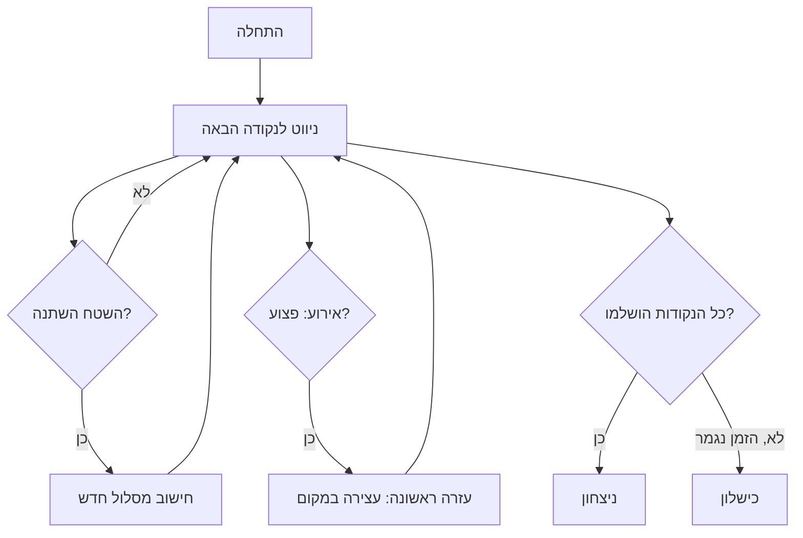

# Level Design: השטח משתנה, המשימה נשארת (Mission Terrain)

## 1. רקע מהמחקר ומקהל היעד

- **קהל ראשי:** חיילים ומפקדים שצריכים להכיר סביבה בנויה, לתרגל ניווט וקבלת החלטות בלחץ, ועבודת צוות.
- **קהל מוסדי:** יחידות אימון, בתי ספר לקצינים, וצוותי חילוץ וחירום.
- **מה מניע אותם:** אימון זול, בטוח וחוזר על עצמו, ותחושת התקדמות ואתגר.
- **מתחרים:** VBS4 (כלי מקצועי ומורכב), Sea Hero Quest (ניווט לשחקן יחיד), EMERGENCY 5 (מבט מלמעלה), Fire Disaster Simulation VR (תרחיש אחד).
- **הבדל שהשלבים צריכים להציג:** אותה סביבה משתנה בכל שלב, ומשחק קבוצתי מתחיל כבר בשלבי הביניים.

**מה מזה נובע לתכנון השלבים:** השלבים עוברים מהיכרות עם המרחב, דרך אירועים בלתי צפויים, ועד עבודת צוות תחת לחץ. כל שלב מוסיף משתנה אחד בכל פעם.

---

## 2. סקירת השלבים

| שלב | סוג | מה השחקן לומד | שחקנים | שינויים בשטח | אירועים |
|---|---|---|---|---|---|
| 0 | הדרכה | תנועה, מפה, נקודת ציון | 1 | אין | אין |
| 1 | קל | ניווט במרחב קבוע עם כמה נקודות | 1–2 | חסימת כביש אחת, קבועה | אין |
| 2 | בינוני | ניווט מחדש כשהשטח משתנה, תיעדוף | 3 | חסימות אקראיות כל 2 דקות | פצוע אחד |
| 3 | קשה | תיאום צוות תחת לחץ זמן | 4 | שינויים כל דקה, עשן מתפשט | שני אירועים במקביל |

---

## 3. פירוט כל שלב

### שלב 0: הדרכה
- **מטרה:** השחקן מבין תנועה, מפה, ונקודת ציון.
- **מה קורה:** מפה קטנה ושטוחה. סמן מוצב בנקודת ציון אחת. השחקן מגיע אליה.
- **תנאי ניצחון:** הגעה לנקודת הציון.
- **מה נלמד:** שימוש במפה, והבנה שיש מדד חיים אישי שיורד בהתנגשות.

### שלב 1: קל
- **מטרה:** השחקן לומד לתכנן מסלול לפי מפה.
- **מה קורה:** שטח בנוי בגודל בינוני, עם שלוש נקודות ציון. כביש אחד חסום מההתחלה, והשחקן צריך לבחור דרך אחרת.
- **תנאי ניצחון:** הגעה לשלוש נקודות בתוך זמן סביר.
- **שחקנים:** יחיד, או שניים שמחלקים את הנקודות ביניהם.

### שלב 2: בינוני
- **מטרה:** השחקן לומד להתאים את התוכנית כשהשטח משתנה.
- **מה קורה:** כל שתי דקות, שניים עד שלושה כבישים נחסמים או נפתחים באקראי. מופיע פצוע אחד שצריך לעזור לו (מדד החיים האישי יורד אם מתעכבים).
- **תנאי ניצחון:** השלמת כל נקודות הציון, ושמירה על מדד החיים מעל סף.
- **שחקנים:** שלושה, עם תפקידים: מוביל, נווט, ועזרה ראשונה.

### שלב 3: קשה
- **מטרה:** השחקן לומד לתאם צוות תחת לחץ.
- **מה קורה:** השטח משתנה כל דקה. עשן מתפשט מנקודה אחת, וחוסם אזורים שלמים. שני אירועים מתרחשים במקביל: פצוע ונקודת ציון שנסגרת.
- **תנאי ניצחון:** השלמה לפני שהזמן נגמר, ומדד הצוות מעל הסף.
- **שחקנים:** ארבעה.

---

## 4. דיאגרמה: מבנה השלב הבינוני (בהמשך מוצג בשלבים 2 ו-3)



---

## 5. דיאגרמה: מפת השטח (שלב 1)

```
+---------+---------+---------+
|  [1]    |  XXXXX  |         |
|         |  XXXXX  |   [2]   |
|  START  |         |         |
|    @    |   [3]   |  ~~~~~  |
|         |         |  ~~~~~  |
+---------+---------+---------+

@     = השחקן             [1][2][3] = נקודות ציון
XXXXX = כביש חסום (קבוע)   ~~~~~     = אזור בלתי עביר
```

---

## 6. מה כבר ממומש ומה עוד מתוכנן

- **עדיין לא ממומש.** זה תכנון לשלבים של Mission Terrain.
- **הצעד הבא:** לבנות את שלב 0 כאב-טיפוס: מפה קטנה, נקודת ציון אחת, ומדד חיים אישי.

---

## 7. בדיקה מול משתמשים

- לבדוק את שלב 1 עם מדריך אימון אחד או שניים, ולמדוד: האם הם מוצאים את הדרך החלופית בלי עזרה?
- לתקן: אם שחקנים מתקשים לזהות את הכביש החסום, להוסיף סימון ברור על המפה.
